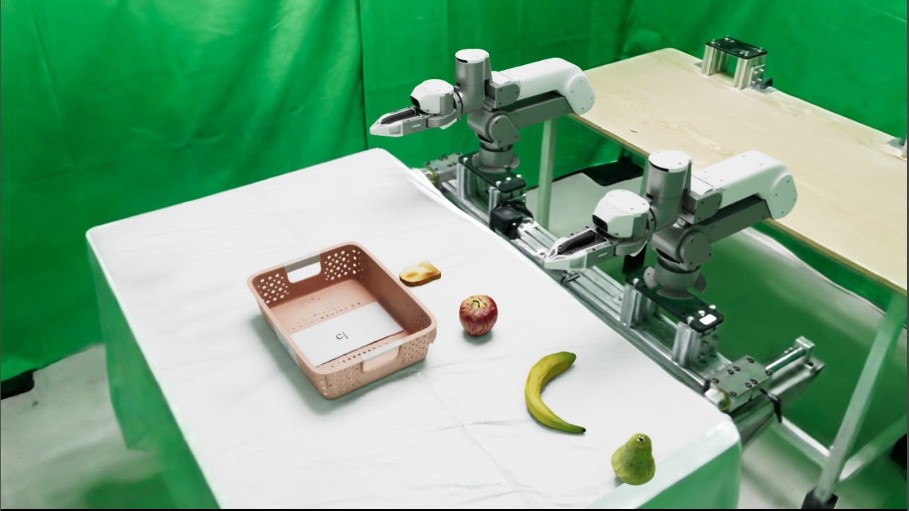
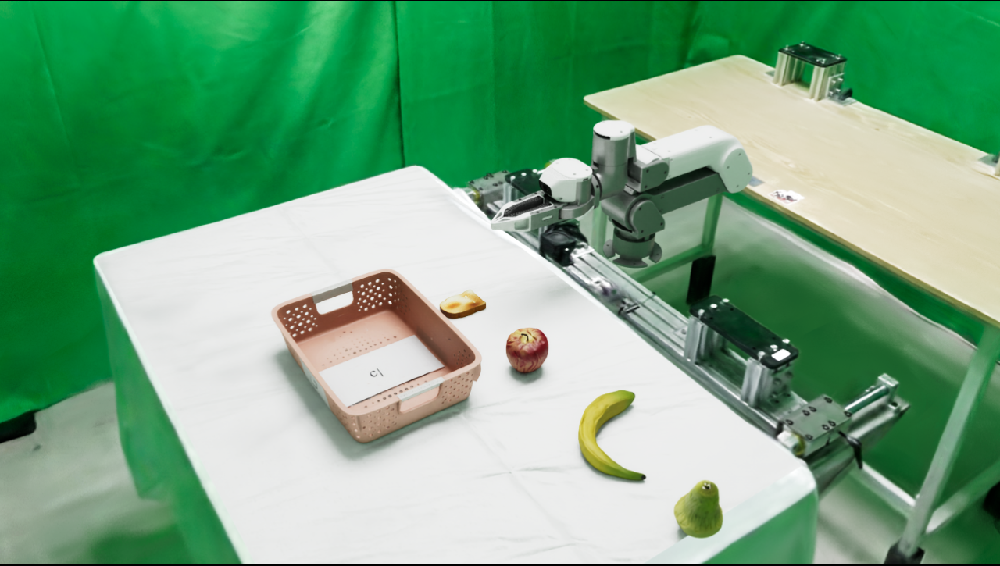

# ArtiXon Arm-6A SDK ROS2

桌面 SDK 使用 `assets/bimanual_robot/bimanual_robot_G.usd`，夹爪指令范围为
`0–1.89 rad`。桌面任务继续使用 `bimanual_robot_H.usd`，夹爪范围为
`0–5.717175 rad`。

SDK 默认打开水果桌面场景。场景不设置任务目标、成功条件或自动重置，也不录制数据。
依赖和环境安装见 [安装说明](install.md)。

## 启动

```bash
source 3rd/isaaclabarena/.venv/bin/activate
export OMNI_KIT_ACCEPT_EULA=YES ACCEPT_EULA=Y ENABLE_CAMERAS=1
source /opt/ros/jazzy/local_setup.bash
python scripts/sdk_ros2.py --robot artixon_arm_6a --viz kit
```

配置：`configs/sdk_ros2/artixon_arm_6a_sdk_ros2.yaml`。可用 `--config PATH` 指定自定义配置。
无界面运行使用 `--viz none`；窗口聚焦后按 R 重置，关闭窗口或 Ctrl-C 退出。

只启动一只 G 夹爪单臂：

```bash
python scripts/sdk_ros2.py --robot artixon_arm_6a_left --viz kit
python scripts/sdk_ros2.py --robot artixon_arm_6a_right --viz kit
```

对应 USD 为 `bimanual_robot_G_left.usd` 和 `bimanual_robot_G_right.usd`。
两个文件都以单臂根部的 `base_link` 为原点，不加载头部相机；左臂使用 `camera1`，右臂使用 `camera3`。

## 演示

抓水果桌面场景中的 ArtiXon Arm-6A 仿真：



单臂 SDK 场景：



## 控制与状态

每臂关节顺序为 `left_arm_joint1`…`6` / `right_arm_joint1`…`6`，角度单位为弧度。

| 接口 | 话题 | 类型 / 语义 |
| --- | --- | --- |
| 末端指令（ee） | `/left_arm_cartesian_controller/pose_cmd`、`/right_arm_cartesian_controller/pose_cmd` | `PoseStamped`，相对 reset/home 零位的法兰位姿；向量使用 `base_link` 轴 |
| 关节指令（joint） | `/left_arm_joint_controller/commands`、`/right_arm_joint_controller/commands` | `Float64MultiArray`，每臂 6 值 |
| 夹爪指令 | `/left_gripper_controller/commands`、`/right_gripper_controller/commands` | `Float64MultiArray`，单值 0–1.89 |
| 双臂状态 | `/left_arm/joint_states`、`/right_arm/joint_states` | `JointState` |
| 法兰状态 | `/left_arm/end_pose`、`/right_arm/end_pose` | `PoseStamped`，相对 reset/home 零位的法兰位姿；向量使用 `base_link` 轴 |
| 夹爪状态 | `/left_gripper/joint_states`、`/right_gripper/joint_states` | `JointState` |
| 全关节状态 | `/joint_states` | `JointState` |

单臂模式只保留所选一侧的同名接口。例如左臂使用 `/left_arm_cartesian_controller/pose_cmd`、
`/left_gripper_controller/commands`、`/left_arm/end_pose` 和 `/left_gripper/joint_states`；右臂将
`left` 替换为 `right`。单臂 action 为 7 维（6 个关节加 1 个夹爪），两种模式相同。

末端为 `left_arm_link6` / `right_arm_link6` 法兰。位置单位米，四元数 **XYZW**。
reset 后当前法兰 pose 定义为零位：位置输出为相对零位的位移，姿态为
`q_relative = q_target * inverse(q_home)`。指令使用同一语义，位置是相对位移，姿态是
`q_target = q_relative * q_home`。`header.frame_id` 固定使用 `neutral`（空值也按该坐标系处理）；
先读取 `/left_arm/end_pose` 或右臂对应状态，再发送相对目标。

### 控制模式与切换服务

仿真环境统一使用关节位置控制。`ee` 模式在 ROS 桥内用 `maniparena_sim.kinematics` 的求解器
（从机器人 USD 的 PhysX 关节链提取运动学，阻尼最小二乘加 Armijo 线搜索）把末端位姿解成关节目标，
`joint` 模式直接写入关节目标，两种模式共用同一套关节驱动。

`ros.arm_control`（`ee` 或 `joint`，默认 `ee`）只决定启动时的模式。运行中用
`std_srvs/srv/SetBool` 服务 `/set_arm_control_mode` 切换（名称可用 `ros.mode_service` 修改）：

- `data: true` 为 `ee`，`data: false` 为 `joint`。
- 服务端保存当前模式。响应的 `message` 始终是生效后的模式（`ee` 或 `joint`），`success: false` 表示切换失败，模式保持不变。
- 请求的模式与当前相同时不做任何改动，直接返回该模式。SetBool 没有只读查询，请求总是被当作期望模式。
- 切换时手臂保持当前关节目标。服务端只订阅当前模式的臂指令话题，切换后请等待约 0.1 s 让订阅重新建立，再发送新模式的指令。
- 切换后 `end_pose` / 关节状态在两种模式下都会发布。

```bash
ros2 service call /set_arm_control_mode std_srvs/srv/SetBool "{data: false}"   # -> message: joint
```


双臂启用相机时发布 `/camera1/usb_cam1/image_raw/image_compressed`、
`/camera3/usb_cam3/image_raw/image_compressed` 和 `/camera_head_front/color/image_raw/compressed`；
单臂只发布所选腕部相机，不发布头部相机。
`use_sim_time: true` 时发布 `/clock`。本机型没有底盘、升降和头部关节控制接口。
默认物理 120 Hz、控制 20 Hz、渲染调度 60 Hz；实际运行帧率另受计算与渲染耗时影响。
