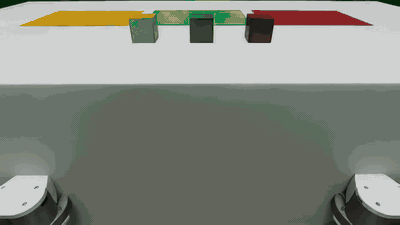
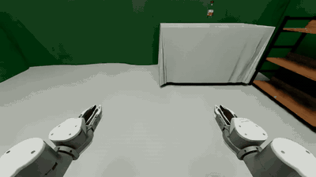

# QUANTA_X1 使用指南

# 遥操作采集

采集入口为 `scripts/collect.py`，配置文件按控制方式区分（`keyboard` / `vuer` / `vr`）。

## 支持的任务

| Task | 底盘 | 说明 |
|------|------|------|
| `sort_blocks` | 固定 | 将三个彩色方块放到对应颜色的纸上 |
| `fruits_to_basket` | 固定 | 将苹果、香蕉、梨放入篮子，面包为干扰物 |
| `move_bottle_to_bin` | 移动 | 将桌上的瓶子放入垃圾桶 |
| `move_fruit_to_basket` | 移动 | 将水果桌上的水果放入另一张桌上的篮子 |
| `put_bottle_on_woodshelf` | 移动 | 将桌上的瓶子放到木架上 |

五个任务都支持键盘和 Vuer WebXR，`vr` 是 `vuer` 的别名。每回合物体随机，移动任务的机器人起点也随机；成功条件是物体到达目标且双臂回到初始姿态。

手臂目标位姿统一在 `lift_link` 坐标系下表达，升降（lift）运动不会改变手臂指令；采集记录的 19D 动作、Wall-X 评测和 SDK 的末端位姿接口使用同一坐标系语义。

固定底盘任务使用 `assets/green_booth/`；移动任务使用 `assets/put_bottle_on_woodshelf/` 和 `assets/mobile_manip/`。`move_bottle_to_bin`、`move_fruit_to_basket` 的对象默认从对象池随机选择，并在当前进程内保持不变；可通过 `scene_options.seed`、`bottle`、`fruit`、`basket` 指定。

底盘参数（标定值，与 `QUANTA_X1_WHEEL_RADIUS_M` / `QUANTA_X1_WHEEL_TRACK_WIDTH_M` 一致）：`wheel_radius=0.0845`、`wheel_track_width=0.415`。Wall-X 全身推理见下文「Wall-X 评测」。

## 采集命令

### 键盘

Isaac Lab / Sim **6.0** 默认无界面；需要 Kit 视口时加 `--viz kit`（键盘遥操作必须）。

```bash
python scripts/collect.py \
  --robot quanta_x1 \
  --task fruits_to_basket \
  --control-mode keyboard \
  --config configs/collect/keyboard.yaml \
  --viz kit
```

将 `fruits_to_basket` 换成上表其他任务即可切换。

### Vuer（Pico WebXR）

```bash
python scripts/collect.py \
  --robot quanta_x1 \
  --task fruits_to_basket \
  --control-mode vuer \
  --config configs/collect/vuer.yaml \
  --viz kit
```

启动后默认 WebSocket 端口 `8012`（可在 `configs/collect/vuer.yaml` 的 `teleop_config.vuer_port` 修改）。Pico 走 USB `adb reverse`，浏览器打开 Vuer 客户端并连到本机端口：

```bash
adb reverse tcp:8012 tcp:8012
```

Pico 浏览器打开：

```text
https://vuer.ai?ws=ws://localhost:8012
```

进页面后点 Enter VR；终端应出现 `Vuer WebSocket connected`。Left-X 开始遥操，Left-Y 标记成功，Right-A 重置。

## 键盘控制

启动后**点击 Isaac Sim 视口**使窗口获得焦点，否则按键无效。

| 按键 | 功能 |
|------|------|
| `B` | 切换控制目标：左臂 → 右臂 → 底盘 |
| `W` / `S` / `A` / `D` / `Q` / `E` | 平移当前目标（手臂或底盘） |
| `Z` / `X` / `T` / `G` / `C` / `V` | 旋转当前手臂（底盘模式下无效） |
| `K` | 切换当前手臂夹爪开/合（映射到关节 `0` ~ `1.89`） |
| `H` | 标记本 episode 成功并导出 |
| `R` | 放弃本 episode / 重置 |

底盘模式下：`W`/`S` 前进后退，`A`/`D` 或 `Q`/`E` 转向。

灵敏度可在 `configs/collect/keyboard.yaml` 调整：

```yaml
teleop_config:
  position_scale: 0.02
  rotation_scale: 0.2
```

## Vuer 控制

首次进入需用**左手 X** 开始遥操作（捕获参考位姿），之后：

| 输入 | 功能 |
|------|------|
| 双手手柄位姿 | 双臂绝对 IK 目标（增量映射到基座坐标系） |
| 扳机（Trigger） | 夹爪连续开合（`0` ~ `1.89`） |
| 左摇杆 | 底盘线速度 / 角速度 |
| 右摇杆 | 升降台（lift） |
| 左手 X | 开始 / 重新捕获遥操作参考 |
| 左手 Y | 标记本 episode 成功并导出 |
| 右手 A | 放弃本 episode / 重置 |

## 录制输出

- 默认目录：`~/maniparena_output/recordings/quanta_x1_<task>_collect/`
- 格式：每个 episode 同时写 HDF5 和 `lerobot/` 下的 LeRobot parquet；相机仍写为 HDF5 同目录的 sidecar MP4（左腕 / 右腕 / 头部 RGB，相机深度不写入 MP4）
- HDF5 每帧保存 action、processed action、机器人状态、物体状态和观测；QUANTA_X1 遥操 action 为 19D，评测 action 为 21D
- LeRobot 的 `action` 保留遥操实际 19D；`observation.state` 保存 23D 关节状态，不需要再做格式转换。若只需旧的 HDF5 输出，可在采集 YAML 中设置 `format: "hdf5"`。
- QUANTA_X1 评测记录同样双写；评测 LeRobot `action` 为 21D，并包含额外的 `head_yaw` / `head_pitch` 两列。
- 帧率：由配置 `step_hz` 决定，当前统一为 **20 Hz**

示例：

```text
~/maniparena_output/recordings/quanta_x1_fruits_to_basket_collect/
  quanta_x1_fruits_to_basket_collect_vr_episode0.hdf5
  lerobot/
    data/chunk-000/episode_000000.parquet
    meta/info.json
  quanta_x1_fruits_to_basket_collect_vr_episode0_videos/
    ...
```

## 演示

Vuer 遥操作 `fruits_to_basket` 三相机拼接预览（左腕 / 头部 / 右腕）：


---

# Wall-X 评测

QUANTA_X1 支持使用开源的 [Wall-X](https://github.com/X-Square-Robot/wall-x)（WALL-OSS 系列模型）进行闭环评测。评测入口为 `scripts/eval.py`，通过 WebSocket 连接 Wall-X 推理服务，服务的启动方式参见 Wall-X 仓库 README 中的 “WebSocket Serving”。更多评测任务可参考 [X2Real](https://github.com/X-Square-Robot/x2real)。

## 运行

先启动 Wall-X 推理服务，再运行（以 `put_bottle_on_woodshelf` 为例）：

```bash
python scripts/eval.py \
  --robot quanta_x1 --task put_bottle_on_woodshelf \
  --config configs/eval/quanta_x1_put_bottle.yaml \
  --server-address 127.0.0.1 --server-port 8000 \
  --viz kit
```

需要 Kit 视口时使用 `--viz kit`；批量评测无需界面时改用 `--viz none`。

每个任务对应的配置文件：

| `--task` | `--config` | `max_steps` |
|----------|-----------|-------------|
| `sort_blocks` | `configs/eval/quanta_x1_sort_blocks.yaml` | 800 |
| `fruits_to_basket` | `configs/eval/quanta_x1_fruits_to_basket.yaml` | 800 |
| `move_bottle_to_bin` | `configs/eval/quanta_x1_move_bottle_to_bin.yaml` | 3000 |
| `move_fruit_to_basket` | `configs/eval/quanta_x1_move_fruit_to_basket.yaml` | 3000 |
| `put_bottle_on_woodshelf` | `configs/eval/quanta_x1_put_bottle.yaml` | 3000 |

回合超时后环境重置并计为一个回合。`--server-address` / `--server-port` 指向 Wall-X 推理服务。

## 评测设置

评测使用独立的环境构建（`build_quanta_x1_eval_gym_env`），仅作用于 `eval.py`，不影响采集和 SDK。

| 项 | 取值 | 说明 |
|----|------|------|
| 仿真步长 | 物理 240 Hz，环境 30 Hz（decimation 8） | 相机每个环境步渲染一次 |
| 动作块 | `action_horizon=32`、`action_chunk_length=32` | 整个动作块执行后重新推理 |
| 插值 | `interpolation_multiplier=1.5` | 一个动作块对应 48 个环境步 |
| 回合步数上限 | 固定底盘任务 800，移动任务 3000 | 由 `max_steps` 设置 |
| 指令 | 与训练数据中对应任务的文本一致 | 见各配置文件的 `instruction` |
| 手臂坐标系 | `lift_link` | 手臂位姿指令与状态均在 `lift_link` 坐标系下表达，lift 运动不改变手臂指令 |
| 相机 | 头部 1280×720 标定针孔相机，腕部鱼眼相机 | 与采集、SDK 一致，镜头畸变模型由 `enable_usd_lens_models()` 写入相机 USD；评测中不启用仅输出深度的底盘相机 |
| 物体与布局 | `sort_blocks`、`fruits_to_basket` 使用 `assets/quanta_x1_objects/` 下带 `_2` 后缀的资产 | 场景与桌面臂任务分别构建（`scene_builder.py`） |
| 固定底盘出生位姿 | `sort_blocks`：`pos=(-0.52, -0.26, -0.985)`；`fruits_to_basket`：`pos=(-0.60, -0.26, -0.985)`；head pitch 均为 0.35 | 见 `task/quanta_tabletop_layouts.py` |

### Lift 指令

训练数据中各任务的 lift 指令全程恒定：`sort_blocks` 为 0.455 m，其余任务为 0.379 m。评测时 lift 不由模型控制，`eval.py` 按任务固定该值，可用 `policy_config.lift_hold` 覆盖。

### 字段映射

训练数据（LeRobot v3.0，26 维，30 fps）状态与动作的末尾 6 维按 `[底盘速度 (vx, vy, wz), lift, 头部 (yaw, pitch)]` 排列，与推理服务按字段名组织的顺序不同。评测客户端（`wire_layout: dataset`，默认）按训练数据的顺序填写请求中的 `state`，并从响应中还原对应的指令：

| 训练数据中的量 | 请求 `state` 字段 | 响应字段 |
|----------------|-------------------|----------|
| 底盘速度 vx、vy | `head_pos` | `head_pos` |
| 底盘角速度 wz | `lift` | `lift` |
| lift、头部 yaw、pitch | `velocity_decomposed` | `velocity_decomposed_odom` |

该映射要求推理服务将 `head_pos` 槽位按模型预测值返回，而不是回显请求中的状态。

### 录制

`enable_recording: true` 时，每个回合（包括成功回合）单独导出一个 hdf5 文件，以及头部、左腕、右腕三路相机的 mp4。

### 评测示例

Wall-X 闭环评测中的头部相机视角（加速播放）：

`sort_blocks`：



`put_bottle_on_woodshelf`：



---

# SDK ROS2

## ROS 环境配置

ROS2 桥依赖 Isaac Sim 的 `isaacsim.ros2.bridge` 扩展。当前为 Isaac Sim **6.0**（Python 3.12），按官方 ROS 2 Jazzy 安装即可：

参考：<https://docs.ros.org/en/jazzy/Installation.html>

## 启动命令

先按主 [README](../README.md) 激活仿真环境，再 source ROS 2，最后启动：

```bash
source 3rd/isaaclabarena/.venv/bin/activate
export OMNI_KIT_ACCEPT_EULA=YES ACCEPT_EULA=Y
export ENABLE_CAMERAS=1
source /opt/ros/jazzy/local_setup.bash
python scripts/sdk_ros2.py \
  --config configs/sdk_ros2/quanta_x1_sdk_ros2.yaml \
  --viz kit
```

初始 Kit 视口对准机器人一次（`viewer_cfg.origin_type: world`），之后不跟车。可在
`configs/sdk_ros2/quanta_x1_sdk_ros2.yaml` 改 `eye` / `lookat`（世界系，单位米）。

启动后键盘控制（先点击 Isaac Sim 视口获取焦点）：

| 按键 | 功能 |
|------|------|
| `W` / `S` | 底盘前进 / 后退 |
| `A` / `D` 或 `Q` / `E` | 底盘转向 |
| `R` | 重置机器人到初始位姿 |

外部 ROS2 节点同时可通过 `/chassis/cmd_vel` 驱动底盘，速度与键盘叠加。

## ROS2 话题

ROS 节点名为 `sx001_ros_communicator`，话题合同见 `src/maniparena_sim/ros/quanta_x1_sdk_topics.py`。

| Topic Name | Message Type |
|------------|--------------|
| **PUBLISHERS** | |
| `/joint_states` | `JointState` |
| `/left_arm/joint_states` / `/right_arm/joint_states` | `JointState` |
| `/left_gripper/joint_states` / `/right_gripper/joint_states` | `JointState`（0–1.89） |
| `/head/joint_states` | `JointState` |
| `/lift/joint_states` | `JointState` |
| `/left_arm/end_pose` / `/right_arm/end_pose` | `PoseStamped` |
| `/odom` | `Odometry` |
| `/tracked_pose` | `PoseStamped` |
| `/hal/chassis/imu` | `Imu` |
| `/scan` | `LaserScan`（RTX 直出） |
| `/tf` / `/tf_static` | TF（`a_d_laser` 在 static） |
| `/clock` | `Clock`（`use_sim_time: true`） |
| `/camera_chassis_front/depth/points` | `PointCloud2` |
| `/camera1/...` / `/camera3/...` | 左右腕 RGB |
| `/camera_head_front/color/image_raw/compressed` | 头 RGB |
| **SUBSCRIBERS** | |
| `/left_arm_cartesian_controller/pose_cmd` / `/right_arm_cartesian_controller/pose_cmd` | `PoseStamped`（`ros.arm_control: ee`） |
| `/left_arm_joint_controller/commands` / `/right_arm_joint_controller/commands` | `Float64MultiArray`（`ros.arm_control: joint`） |
| `/left_gripper_controller/commands` | `Float64MultiArray`（0–1.89） |
| `/right_gripper_controller/commands` | `Float64MultiArray`（0–1.89） |
| `/head_position_controller/commands` | `Float64MultiArray` |
| `/lift_position_controller/commands` | `Float64MultiArray` |
| `/chassis/cmd_vel` | `Twist`（超时 0.25 s 清零） |

双臂控制由 YAML `ros.arm_control` 选择，默认 **`ee`**：

```yaml
ros:
  arm_control: ee    # 或 joint
```

## 演示

`nav_f16` 场景中的 QUANTA_X1 仿真：


RViz 中点云、`/scan` 与 TF 可视化：


