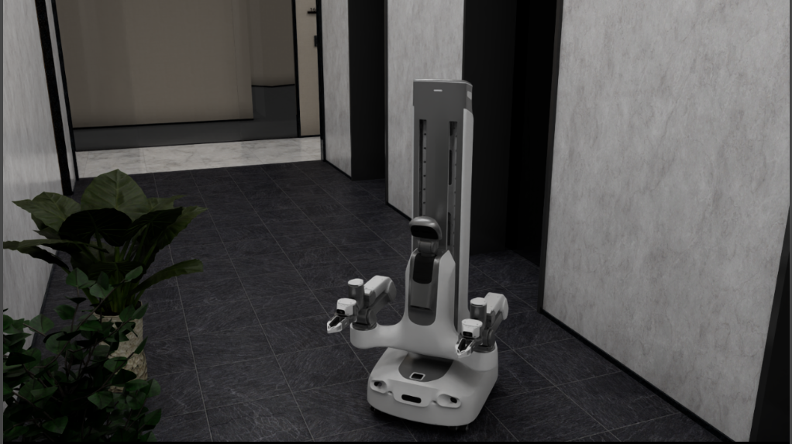
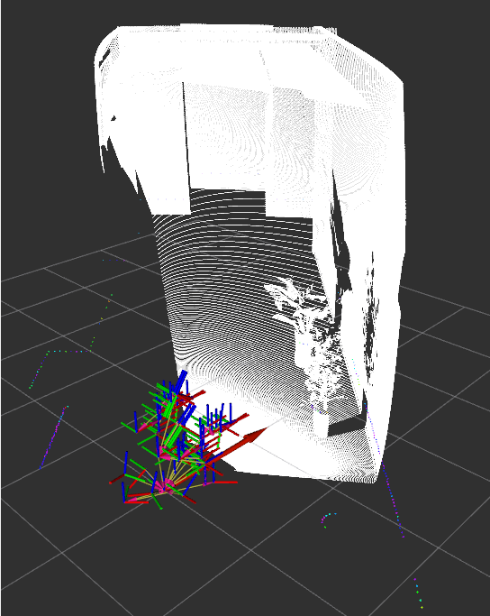

# QUANTA_X1 SDK ROS2

数据采集和 Wall-X 评测见 [QUANTA_X1 使用指南](quanta_x1.md)。

## ROS 环境配置

ROS2 桥依赖 Isaac Sim 的 `isaacsim.ros2.bridge` 扩展。当前为 Isaac Sim **6.0**（Python 3.12），按官方 ROS 2 Jazzy 安装即可：

参考：<https://docs.ros.org/en/jazzy/Installation.html>

## 启动命令

先按主 [README](../README.md) 激活仿真环境，再 source ROS 2，最后启动：

```bash
source 3rd/isaaclabarena/.venv/bin/activate
export OMNI_KIT_ACCEPT_EULA=YES ACCEPT_EULA=Y
export ENABLE_CAMERAS=1
source /opt/ros/jazzy/local_setup.bash
python scripts/sdk_ros2.py \
  --config configs/sdk_ros2/quanta_x1_sdk_ros2.yaml \
  --viz kit
```

初始 Kit 视口对准机器人一次（`viewer_cfg.origin_type: world`），之后不跟车。可在
`configs/sdk_ros2/quanta_x1_sdk_ros2.yaml` 改 `eye` / `lookat`（世界系，单位米）。

启动后键盘控制（先点击 Isaac Sim 视口获取焦点）：

| 按键 | 功能 |
|------|------|
| `W` / `S` | 底盘前进 / 后退 |
| `A` / `D` 或 `Q` / `E` | 底盘转向 |
| `R` | 重置机器人到初始位姿 |

外部 ROS2 节点同时可通过 `/chassis/cmd_vel` 驱动底盘，速度与键盘叠加。

## ROS2 话题

ROS 节点名为 `sx001_ros_communicator`，话题合同见 `src/maniparena_sim/ros/quanta_x1_sdk_topics.py`。

| Topic Name | Message Type |
|------------|--------------|
| **PUBLISHERS** | |
| `/joint_states` | `JointState` |
| `/left_arm/joint_states` / `/right_arm/joint_states` | `JointState` |
| `/left_gripper/joint_states` / `/right_gripper/joint_states` | `JointState`（0–1.89） |
| `/head/joint_states` | `JointState` |
| `/lift/joint_states` | `JointState` |
| `/left_arm/end_pose` / `/right_arm/end_pose` | `PoseStamped` |
| `/odom` | `Odometry` |
| `/tracked_pose` | `PoseStamped` |
| `/hal/chassis/imu` | `Imu` |
| `/scan` | `LaserScan`（RTX 直出） |
| `/tf` / `/tf_static` | TF（`a_d_laser` 在 static） |
| `/clock` | `Clock`（`use_sim_time: true`） |
| `/camera_chassis_front/depth/points` | `PointCloud2` |
| `/camera1/...` / `/camera3/...` | 左右腕 RGB |
| `/camera_head_front/color/image_raw/compressed` | 头 RGB |
| **SUBSCRIBERS** | |
| `/left_arm_cartesian_controller/pose_cmd` / `/right_arm_cartesian_controller/pose_cmd` | `PoseStamped`（`ros.arm_control: ee`） |
| `/left_arm_joint_controller/commands` / `/right_arm_joint_controller/commands` | `Float64MultiArray`（`ros.arm_control: joint`） |
| `/left_gripper_controller/commands` | `Float64MultiArray`（0–1.89） |
| `/right_gripper_controller/commands` | `Float64MultiArray`（0–1.89） |
| `/head_position_controller/commands` | `Float64MultiArray` |
| `/lift_position_controller/commands` | `Float64MultiArray` |
| `/chassis/cmd_vel` | `Twist`（超时 0.25 s 清零） |

头部相机为 1280×720 标定针孔相机，腕部相机为鱼眼相机，镜头畸变模型与数据采集、Wall-X 评测一致。

双臂控制由 YAML `ros.arm_control` 选择，默认 **`ee`**：

```yaml
ros:
  arm_control: ee    # 或 joint
```

## 演示

`nav_f16` 场景中的 QUANTA_X1 仿真：



RViz 中点云、`/scan` 与 TF 可视化：


