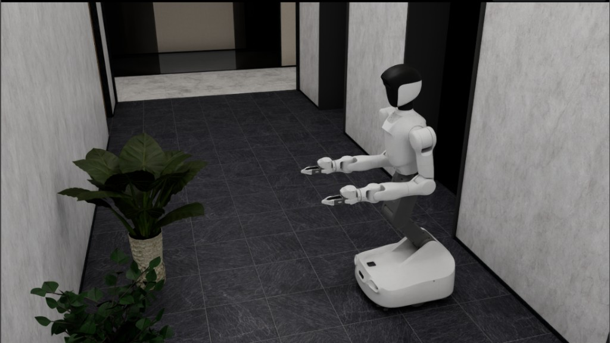

# quanta_x2 SDK ROS2

仅包含仿真 SDK 接口。默认加载空导航场景，没有成功判定、超时或自动重置，也不录制数据。
依赖和环境安装见 [安装说明](install.md)。

## 启动

整机模型位于 `assets/quanta_x2/quanta_x2.usd`，模型自身包含双臂和双 G 夹爪，
直接加载这个 USD，依赖均从仓库本地加载。
按安装说明执行 `git lfs pull` 取得资产即可。关节顺序见
`src/maniparena_sim/ros/sdk_profiles.py`。自定义模型可修改 `robot.usd_path`，相对路径按仓库根目录解析；使用自定义 USD 时请选 `ros.ik_backend: arm`。全身 QP 的模型数据与仓库自带 USD 校验绑定。

```bash
source 3rd/isaaclabarena/.venv/bin/activate
export OMNI_KIT_ACCEPT_EULA=YES ACCEPT_EULA=Y ENABLE_CAMERAS=1
source /opt/ros/jazzy/local_setup.bash
python scripts/sdk_ros2.py --robot quanta_x2 --viz kit
```

配置：`configs/sdk_ros2/quanta_x2_sdk_ros2.yaml`。可用 `--config PATH` 指定自定义配置。
无界面运行使用 `--viz none`。窗口聚焦后，W/S 前后、A/D 转向、R 重置；关闭窗口或 Ctrl-C 退出。
键盘速度与 `/chassis/cmd_vel` 叠加；ROS 速度超过 0.25 秒仿真时间未更新会清零。
启动和按 R 均恢复双臂默认姿态：按 SDK 关节顺序，左臂为
`[-90, 90, 90, -90, 0, 0, 0]°`，右臂为 `[-90, -90, 90, -90, 0, 0, 0]°`。
此处角度用于说明姿态，ROS 关节指令仍使用弧度。

## 演示

空导航场景中的 quanta_x2 仿真：



## 控制与状态

姿态采用 ROS **XYZW**，距离为米，关节角为弧度。

| 接口 | 话题 | 类型 / 语义 |
| --- | --- | --- |
| 末端指令（ee） | `/left_arm/pose_command/root_frame`、`/right_arm/pose_command/root_frame` | `PoseStamped`，相对 `base_link` 的绝对末端位姿 |
| 关节指令（joint） | `/smoother_command_input_left`、`/smoother_command_input_right` | `Float64MultiArray`，每臂 7 值 |
| 夹爪指令 | `/left_g_gripper_controller/commands`、`/right_g_gripper_controller/commands` | `Float64MultiArray`，单值 0–1.89 |
| 头部指令 | `/head_position_controller/commands` | `Float64MultiArray`，pitch、yaw |
| 腰部指令 | `/waist_forward_position_controller/commands` | `Float64MultiArray`，依次为 `bow_pitch_joint_01`、`02`、`03`、`bow_yaw_joint` |
| 底盘指令 | `/chassis/cmd_vel` | `Twist`，linear.x 与 angular.z |
| 双臂状态 | `/left_arm/state/joint`、`/right_arm/state/joint` | `JointState` |
| 末端状态 | `/whole_body_controller/left_wrist_pose`、`/whole_body_controller/right_wrist_pose` | `PoseStamped`，绝对 `base_link` 坐标 |
| 夹爪状态 | `/left_g_gripper_states/joint_states`、`/right_g_gripper_states/joint_states` | `JointState` |
| 其他状态 | `/joint_states`、`/waist/state/joint`、`/head/joint_states`、`/odom`、`/tracked_pose` | 关节、里程计、世界位姿 |

末端为整机模型的 `left_gripper_base_link` / `right_gripper_base_link`，位置不加夹爪尖端偏移。
`header.frame_id` 使用 `base_link`（空值也按该坐标系处理）。先读取末端状态，再发送附近目标；
不要把零位姿当作“保持当前位置”。

### 带腰部的全身 QP IK

X2 默认使用全身 QP IK，同时求解 4 个腰部关节和双臂各 7 个关节。
通过 `ros.ik_backend` 选择求解器：

```yaml
ros:
  ik_backend: whole_body_qp  # 全身 QP IK；设为 arm 使用独立手臂 IK
```

全身 QP IK 适用于仓库自带的 X2 模型；自定义 USD 请使用 `arm`。
所需的 SciPy 和 OSQP 依赖随项目安装。

- **腰部控制**：EE 模式下，求解器统一生成腰部和双臂关节目标，独立腰部指令不生效。直接控制腰部时切换到 joint 模式。
- **双手目标**：首次有效 EE 指令会捕获当前末端位姿。仅给一只手发送指令时，另一只手以捕获位姿为目标；若已发送双手指令，则同时追踪两个目标。
- **启动与重置**：启动、重置或模式切换后，在收到新 EE 指令前保持关节目标。
- **速度限制**：下发关节目标的速度上限为腰部 0.2 rad/s、手臂 0.8 rad/s。默认控制频率为 20 Hz，支持 10 Hz 及以上。
- **大范围运动**：目标保持不变且局部求解未收敛时，求解器会搜索其他关节解和可行路径。搜索期间保持关节目标；新指令、重置或模式切换会取消当前恢复任务。

大范围运动可能需要绕行，双手在运动途中不保证沿笛卡尔直线移动，也不保证未指定运动的手始终静止。
求解器中的重心和几何间隙约束采用近似模型，不提供完整的网格碰撞检测或动态平衡保证。

### 控制模式与切换服务

仿真环境统一使用关节位置控制。`ee` 模式在 ROS 桥内用 `maniparena_sim.kinematics` 的求解器
把末端位姿解成关节目标，
`joint` 模式直接写入关节目标，两种模式共用同一套关节驱动。

`ros.arm_control`（`ee` 或 `joint`，默认 `ee`）只决定启动时的模式。运行中用
`std_srvs/srv/SetBool` 服务 `/set_arm_control_mode` 切换（名称可用 `ros.mode_service` 修改）：

- `data: true` 为 `ee`，`data: false` 为 `joint`。
- 服务端保存当前模式。响应的 `message` 始终是生效后的模式（`ee` 或 `joint`），`success: false` 表示切换失败，模式保持不变。
- 请求的模式与当前相同时不做任何改动，直接返回该模式。SetBool 没有只读查询，请求总是被当作期望模式。
- 切换时手臂保持当前关节目标。服务端只订阅当前模式的臂指令话题，切换后请等待约 0.1 s 让订阅重新建立，再发送新模式的指令。
- 切换后 `end_pose` / 关节状态在两种模式下都会发布。

```bash
ros2 service call /set_arm_control_mode std_srvs/srv/SetBool "{data: false}"   # -> message: joint
```


相机启用时发布左右腕和头部压缩 RGB、头部深度及底盘点云；IMU、激光雷达仅在对应传感器可用时发布。
`/hal/chassis/imu` 的线加速度沿用 SDK 的 g 单位（1 g ≈ 9.81 m/s²）。
`/clock` 在 `use_sim_time: true` 时发布。若资产的传感器路径不同，可通过 `robot.camera_paths` 覆盖，
或设置 `enable_cameras: false`。默认物理 120 Hz、控制 20 Hz、渲染调度 60 Hz；这些是仿真时间频率，
实际运行速度取决于硬件和渲染负载。
